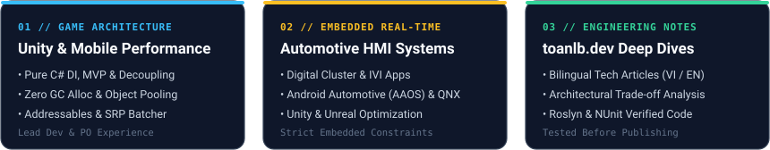
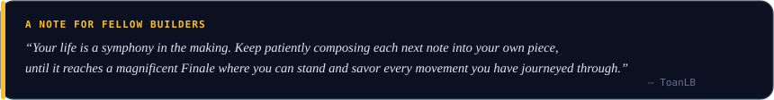

  

 

  
  
  
  
  
  

  
  

---

### About Me

I started out with a degree in **Electronics & Telecommunications Engineering**, spent years building mobile games as a **Unity Developer & Lead PO**, and currently engineer real-time **Automotive HMI** systems (`Cluster` & `IVI` on `AAOS` / `QNX`).

Beyond shipping production features, I write in-depth bilingual engineering notes at **[toanlb.dev](https://toanlb.dev/en/)** — moving past *"how to make it work"* to examine *why an architecture works, what its trade-offs are, and how it behaves under profiler scrutiny*.

  

---

### Featured Engineering Work & Open Source

<table>
  <tr>
    <td width="50%" valign="top">
      <h4>🧪 <a href="https://github.com/toan-lb/toanlb.dev-lab">toanlb.dev-lab</a> — Unity Architecture Sandbox</h4>
      
Companion production-ready code lab for <b>toanlb.dev</b>: Pure C# Dependency Injection, MVP decoupling, lifecycle safety, and automated NUnit test suites.

      

        
        
        
      

    </td>
    <td width="50%" valign="top">
      <h4>🚘 Automotive HMI (Cluster &amp; IVI)</h4>
      
Developing and optimizing embedded automotive human-machine interfaces across <b>Unity</b> and <b>Unreal Engine</b> on <b>Android Automotive (AAOS)</b> and <b>QNX</b> under strict hardware budgets.

      

        
        
        
      

    </td>
  </tr>
  <tr>
    <td width="50%" valign="top">
      <h4>🧱 Voxel Blast &amp; Fruit Block Factory</h4>
      
Led mobile puzzle titles as <b>Lead Developer &amp; PO</b>: rendering 5,000–7,000 simultaneous voxel blocks smoothly on mobile and building lookahead board-solvability simulation.

      

        
        
      

    </td>
    <td width="50%" valign="top">
      <h4>🐟 <a href="https://github.com/toan-lb/unity-aquarium-demo">unity-aquarium-demo</a> &amp; <a href="https://toanlb.dev/en/">toanlb.dev</a></h4>
      
Interactive Unity C# architecture demo alongside 50+ verified technical deep dives on Zero GC Alloc, Addressables reference counting, SRP Batcher, and frame budgets.

      

        
        
      

    </td>
  </tr>
</table>

---

### Selected Articles on [toanlb.dev](https://toanlb.dev/en/)

| Focus Area | Deep Dive / Reflection |
| :--- | :--- |
| **Memory & GC** | [Pursuing Zero Allocation in Unity: Holy Grail or Trap?](https://toanlb.dev/en/posts/pursuing-zero-allocation-unity-holy-grail-or-trap/) |
| **Rendering** | [MaterialPropertyBlock Breaks SRP Batcher: Why and Alternatives](https://toanlb.dev/en/posts/materialpropertyblock-breaks-srp-batcher-why-and-alternatives/) |
| **Loop & Timing** | [FixedUpdate, Time Accumulator, and the Spiral of Death](https://toanlb.dev/en/posts/fixedupdate-time-accumulator-spiral-of-death-unity/) |
| **Architecture** | [Observer Pattern: Instance Class vs Static Class Scope & Lifecycle](https://toanlb.dev/en/posts/observer-pattern-instance-class-vs-static-class/) |
| **Game Craft** | [GTA VI Locking 30 FPS Is Not a GPU Problem: A View on Frame Budgets](https://toanlb.dev/en/posts/gta-vi-30fps-cpu-simulation-frame-budget-perspective/) |

---

### Tech Stack & Toolbox

  
  
  
  
  
  
  
  
  

---

  

