  

  

  
  
  
  
  
  

 

  
  

  

### About Me

Started with a degree in **Electronics & Telecommunications Engineering**, spent nearly a decade shipping mobile puzzle & casual games as a **Unity Developer & Lead PO**, and currently build real-time **Automotive HMI** applications (`Cluster` & `IVI` on `AAOS` / `QNX`).

I write practical, benchmark-backed notes at **[toanlb.dev](https://toanlb.dev/en/)** — digging into *why* an architecture holds up or breaks under real hardware constraints rather than stopping at "it works on my machine."

 

  

 

  

---

### Featured Projects & Open Source

<table>
  <tr>
    <td width="50%" valign="top">
      <h3><a href="https://github.com/toan-lb/toanlb.dev-lab">toanlb.dev-lab</a></h3>
      
Companion code sandbox for <b>toanlb.dev</b>: Pure C# Dependency Injection, MVP decoupling, lifecycle safety, and automated NUnit test suites.

      

        
        
        
      

    </td>
    <td width="50%" valign="top">
      <h3>Automotive HMI (Cluster &amp; IVI)</h3>
      
Developing and optimizing embedded human-machine interfaces across <b>Unity</b> and <b>Unreal Engine</b> on <b>Android Automotive (AAOS)</b> and <b>QNX</b>.

      

        
        
        
      

    </td>
  </tr>
  <tr>
    <td width="50%" valign="top">
      <h3>Voxel Blast &amp; Fruit Block Factory</h3>
      
Shipped mobile puzzle titles as <b>Lead Developer &amp; PO</b>: 5,000–7,000 simultaneous voxel blocks on mobile and lookahead board-solvability simulation.

      

        
        
      

    </td>
    <td width="50%" valign="top">
      <h3><a href="https://github.com/toan-lb/unity-aquarium-demo">unity-aquarium-demo</a> &amp; <a href="https://toanlb.dev/en/">toanlb.dev</a></h3>
      
Interactive Unity C# architecture demo alongside 50+ bilingual technical deep dives on Zero GC Alloc, Addressables, SRP Batcher, and frame budgets.

      

        
        
      

    </td>
  </tr>
</table>

---

### Latest Notes on [toanlb.dev](https://toanlb.dev/en/)

- [Looking at the GTA VI Wave: Why Rockstar Burns Money on Wind-Rippled Shirts While We Cut Every Line Without ROI](https://toanlb.dev/en/posts/gta-vi-wave-micro-details-and-game-metrics-perspective/)
- [GTA VI Locking 30 FPS Is Not a GPU Problem: A Game Developer's View on Frame Budgets](https://toanlb.dev/en/posts/gta-vi-30fps-cpu-simulation-frame-budget-perspective/)
- [Observer Pattern: Instance Class vs Static Class Scope & Lifecycle](https://toanlb.dev/en/posts/observer-pattern-instance-class-vs-static-class/)
- [MaterialPropertyBlock Breaks SRP Batcher: Why and Alternatives](https://toanlb.dev/en/posts/materialpropertyblock-breaks-srp-batcher-why-and-alternatives/)
- [Pursuing Zero Allocation in Unity: Holy Grail or Trap?](https://toanlb.dev/en/posts/pursuing-zero-allocation-unity-holy-grail-or-trap/)

---

### Tech Stack

  
  
  
  
  
  
  
  
  

 

  <picture>
    <source media="(prefers-color-scheme: dark)" srcset="https://raw.githubusercontent.com/toan-lb/toan-lb/output/github-contribution-grid-snake-dark.svg" />
    <source media="(prefers-color-scheme: light)" srcset="https://raw.githubusercontent.com/toan-lb/toan-lb/output/github-contribution-grid-snake.svg" />
    
  </picture>

  

